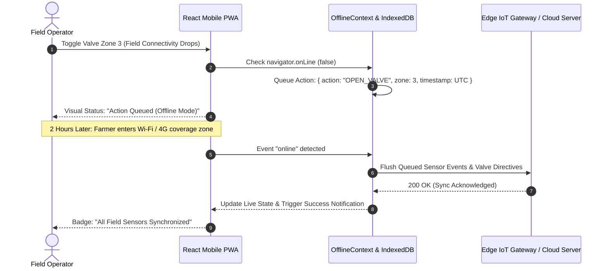
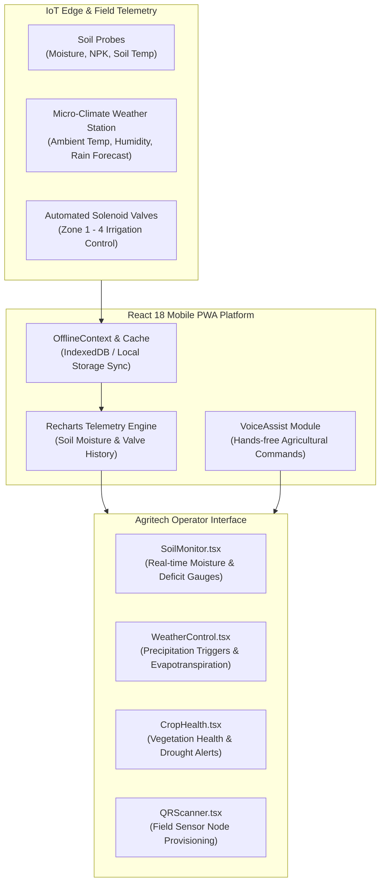

# Smart Irrigation & Precision Agriculture Platform

<p align="center">
  <strong>Offline-First IoT Field Telemetry, Soil Moisture Intelligence, and Voice-Assisted Valve Automation</strong><br>
  <em>Mobile-first agritech PWA engineered for Indian farmers and precision agriculture, providing real-time moisture monitoring, solar-evapotranspiration scheduling, and field node provisioning.</em>
</p>

<p align="center">
  
  
  
  
  
  
  
</p>

---

## Overview

**Smart Irrigation & Precision Agriculture Platform** is a mobile-first Progressive Web Application (PWA) designed to tackle agricultural water mismanagement and crop vulnerability in low-connectivity rural farming environments. Engineered with **React 18**, **TypeScript**, **Vite 6**, and **Tailwind CSS**, the platform bridges cutting-edge Internet of Things (IoT) soil moisture telemetry with accessible, farmer-friendly operational tools.

In rural agricultural belts across India, fluctuating cellular coverage, language barriers, and soiled hands during manual fieldwork frequently render conventional complex desktop dashboards unusable. This platform solves these barriers through an **Offline-First local storage synchronization engine**, a hands-free **Voice Command module**, high-contrast sunlight-readable typography, and camera-based **QR sensor provisioning**.

---

## The Agricultural Water Waste Problem & The Smart Irrigation Solution

### The Challenge
- **Over-Irrigation & Crop Root Rot:** Farmers relying on arbitrary timer-based flood irrigation waste up to 40% of ground water and cause soil salinity, nutrient leaching, and root asphyxiation.
- **Unreliable Rural Connectivity:** Cellular connectivity in deep agricultural fields drops frequently; cloud-reliant irrigation controllers fail to record sensor telemetry or acknowledge manual valve commands when disconnected.
- **Inaccessible Digital Interfaces:** Field operators handling muddy tools or wearing protective gloves cannot easily navigate complex tabular software on reflective mobile screens in direct sunlight.
- **Manual Sensor Pairing Overhead:** Provisioning new IoT soil telemetry probes across sprawling multi-acre plots is error-prone when entering long serial numbers manually.

### The Smart Irrigation Solution
- **Dynamic Evapotranspiration Scheduling:** Integrates real-time micro-climate weather forecasts and volumetric water content (% VWC) to suppress irrigation during rain events and replenish only deficit moisture.
- **Offline-First Synchronous Store:** The app runs continuously without internet access via `OfflineContext` and local caching. Valve schedules and queued commands automatically sync when connectivity is restored.
- **Voice-Assisted Hands-Free Operation:** Integrated Web Speech API (`VoiceAssist.tsx`) enables farmers to check plot moisture or toggle solenoid valves using spoken voice commands.
- **Camera-Based QR Node Provisioning:** Field operators instantly pair and assign new wireless IoT probes to specific crop zones by scanning hardware QR codes.

---

## Offline-First Synchronization Architecture



---

## Core Implemented Capabilities

### 1. Real-Time Soil & Climate Telemetry
- **Soil Intelligence (`SoilMonitor.tsx`):** Tracks Volumetric Water Content (% VWC), soil temperature, and electrical conductivity across distinct irrigation zones.
- **Micro-Climate Monitoring (`WeatherControl.tsx`):** Displays precipitation probability, ambient humidity, and solar radiation to compute evapotranspiration rates.
- **Crop Health Indices (`CropHealth.tsx`):** Analyzes vegetative growth cycles and alerts growers of moisture deficit or waterlogging stress.

### 2. Offline-First Resilience & Sync
- **Zero-Disruption Offline Mode:** The full dashboard and sensor historical charts remain accessible when mobile data disconnects.
- **Queue Synchronization (`OfflineSync.tsx`):** Batches telemetry queries and valve toggles locally, executing a reliable FIFO sync upon network reconnection.
- **Visual Connectivity Indicators (`OfflineBanner.tsx`):** Clear amber banners alert field workers to network status and queued actions.

### 3. Voice-Assisted Field Controls
- **Hands-Free Speech Processing (`VoiceAssist.tsx`):** Voice recognition optimized for agricultural commands (*"Check Zone 2 moisture"*, *"Start drip irrigation on Plot 1"*).
- **Audio Feedback:** Synthesizes spoken confirmations for hands-free confirmation while working in the field.

### 4. IoT Node Provisioning & Multi-Lingual Interface
- **QR Code Pairing (`QRScanner.tsx`):** Instant hardware onboarding via smartphone camera stream, assigning sensor UUIDs to crop zones.
- **Accessible Design:** High-contrast sunlight readability tokens and regional localization framework (`LanguageContext.tsx`).

---

## Soil Telemetry Threshold Reference

| Zone Metric | Deficit Alert | Optimal Band | Waterlogged Alert | Recommended Action |
|---|---|---|---|---|
| **Sandy Loam Moisture** | < 18% VWC | 22% – 32% VWC | > 38% VWC | Automated pulse drip irrigation |
| **Clay Loam Moisture** | < 24% VWC | 28% – 40% VWC | > 46% VWC | Delay irrigation / Check drainage |
| **Root Zone Temperature** | < 12°C (Cold Stunt) | 18°C – 28°C | > 36°C (Thermal Stress) | Adjust canopy shading / mulching |
| **Soil NPK Balance** | Depleted (< 50 ppm) | Balanced (100–250 ppm) | Excessive (> 350 ppm) | Notify fertigation pump controller |

---

## Architecture & Workflow



---

## Technology Stack

Verified directly from source code and package configurations:

| Component | Technology | Description |
|---|---|---|
| **Frontend Core** | React 18.3.1, TypeScript 5.x | Strictly typed, high-performance reactive UI |
| **Build & Bundler** | Vite 6.3.5 (`@vitejs/plugin-react-swc`) | Ultra-fast SWC compilation and hot module replacement |
| **Component System** | Radix UI primitives | Accessible, keyboard and screen-reader compliant UI widgets |
| **Data Visualization** | Recharts 2.15 | Responsive SVG telemetry curves and soil moisture charts |
| **Form & State Management** | React Hook Form & Custom Contexts | Lightweight client-side form validation and state pipelines |
| **Mobile Gestures & Drawers** | Vaul & Embla Carousel | Native mobile drawer physics and carousel transitions |
| **Styling & Tokens** | Tailwind CSS 3.4 | Mobile-first CSS utility framework optimized for high-contrast viewing |

---

## Repository & Directory Structure

```text
Smartirrigationappdesign/
├── src/
│   ├── components/
│   │   ├── ui/               # Radix UI primitives (Accordion, Dialog, Slider, Switch)
│   │   ├── CropHealth.tsx    # Crop growth stage & vegetation vigor indices
│   │   ├── Dashboard.tsx     # Primary farm overview & active zone statuses
│   │   ├── FarmProfile.tsx   # Acreage layout, crop varieties & soil type config
│   │   ├── Navigation.tsx    # Bottom navigation bar for mobile one-handed operation
│   │   ├── OfflineBanner.tsx # Connectivity drop warning pill
│   │   ├── OfflineSync.tsx   # Queued sensor event synchronization manager
│   │   ├── QRScanner.tsx     # Camera-based IoT probe pairing utility
│   │   ├── SoilMonitor.tsx   # Moisture gauges, NPK levels, and deficit warnings
│   │   ├── VoiceAssist.tsx   # Hands-free speech recognition controller
│   │   └── WeatherControl.tsx# Rainfall forecasting and valve scheduling
│   ├── contexts/
│   │   ├── LanguageContext.tsx # Regional language localization provider
│   │   ├── OfflineContext.tsx  # Network state and offline queue manager
│   │   └── ThemeContext.tsx    # High-contrast daylight / night theme provider
│   ├── App.tsx               # Root application coordinator and router
│   ├── index.css             # Tailwind design tokens
│   └── main.tsx              # React DOM mounting entrypoint
├── index.html                # PWA mobile viewport entry
├── package.json              # Dependencies and build scripts
└── vite.config.ts            # Vite bundler configuration
```

---

## Getting Started & Local Development

### Prerequisites
- **Node.js**: `v18.0.0` or higher
- **npm** or **pnpm**

### 1. Clone the Repository
```bash
git clone https://github.com/Swaraj0160/Smartirrigationappdesign.git
cd Smartirrigationappdesign
```

### 2. Install Dependencies
```bash
npm install
```

### 3. Launch Development Server
```bash
npm run dev
```
Navigate to `http://localhost:5173` on desktop or open the network URL on a smartphone connected to the same Wi-Fi.

### 4. Build for Production
```bash
npm run build
npm run preview
```

---

## Author & Acknowledgements

- **Lead Engineer & UI Architect:** **Swaraj Ingale** ([@Swaraj0160](https://github.com/Swaraj0160))
- **Domain:** Precision Agriculture & Sustainable Water Management
- **License:** Open-source under the [MIT License](LICENSE).
