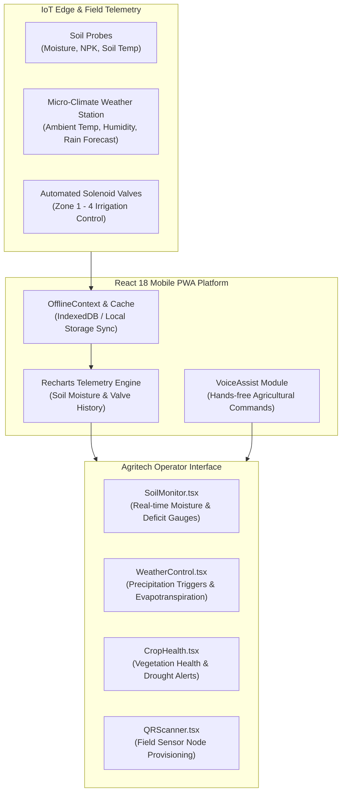

# Precision Agriculture & Smart Irrigation Platform

[](https://react.dev/)
[](https://www.typescriptlang.org/)
[](https://vitejs.dev/)
[](https://www.radix-ui.com/)
[](https://recharts.org/)
[](#offline-first-field-resilience)

A modern, mobile-first precision agriculture and automated irrigation dashboard engineered with **React 18**, **TypeScript**, **Vite 6**, and **Tailwind CSS**. Designed for real-time field sensor telemetry, soil moisture analytics, automated valve control, and voice-assisted agricultural management in low-connectivity rural environments.

---

## System Architecture



---

## Core Capabilities

### 1. Real-Time Soil & Climate Telemetry
- **Soil Intelligence (`SoilMonitor.tsx`):** Tracks volumetric water content (% VWC), NPK fertility levels, and root-zone temperatures across defined farm plots.
- **Micro-Climate Monitoring (`WeatherControl.tsx`):** Incorporates precipitation probability, ambient humidity, and solar radiation to compute evapotranspiration rates and delay irrigation during rainfall.

### 2. Offline-First Field Resilience
- **Rural Connectivity Safeguard (`OfflineContext.tsx`, `OfflineSync.tsx`):** Maintains full dashboard functionality and logging even when cellular data drops in remote fields. Telemetry readings and valve toggle queues automatically synchronize upon reconnection.
- **Status Indicators (`OfflineBanner.tsx`, `StatusBadge.tsx`):** Immediate visual feedback alerting operators of network state and queued actions.

### 3. Accessible Farm Operations
- **Voice-Assisted Controls (`VoiceAssist.tsx`):** Hands-free voice inputs tailored for field conditions where hands may be wet or soiled.
- **Multilingual Support (`LanguageContext.tsx`):** Native language toggling designed for accessibility across rural farming communities.
- **Field Node Provisioning (`QRScanner.tsx`):** Fast camera-based QR pairing for new IoT sensor probes and irrigation valves.

---

## Technology Stack

| Domain | Technologies |
|---|---|
| **Framework & Build** | React 18.3.1, Vite 6.3.5 (`@vitejs/plugin-react-swc`), TypeScript 5 |
| **Component System** | Radix UI primitives (Accordion, Dialog, Popover, Slider, Switch, Tabs) |
| **Visualization** | Recharts 2.15, Lucide React 0.487, Embla Carousel |
| **Form & Feedback** | React Hook Form, Sonner toast notifications, Vaul drawers |
| **Styling** | Tailwind CSS, `class-variance-authority`, `clsx`, `tailwind-merge` |

---

## Directory Structure

```text
Smartirrigationappdesign/
├── src/
│   ├── components/
│   │   ├── ui/               # Radix UI design system primitives (accordion, button, dialog, slider)
│   │   ├── CropHealth.tsx    # Crop growth stage & vegetation vigor indices
│   │   ├── Dashboard.tsx     # Primary farm overview & active zone statuses
│   │   ├── FarmProfile.tsx   # Acreage layout, crop varieties & soil type config
│   │   ├── Navigation.tsx    # Bottom navigation bar for mobile one-handed operation
│   │   ├── OfflineBanner.tsx # Connectivity drop warning pill
│   │   ├── OfflineSync.tsx   # Queued sensor event synchronization manager
│   │   ├── QRScanner.tsx     # Camera-based IoT probe pairing utility
│   │   ├── SoilMonitor.tsx   # Moisture gauges, NPK levels, and deficit warnings
│   │   ├── VoiceAssist.tsx   # Hands-free speech recognition controller
│   │   └── WeatherControl.tsx# Rainfall forecasting and valve scheduling
│   ├── contexts/
│   │   ├── LanguageContext.tsx # Regional language localization provider
│   │   ├── OfflineContext.tsx  # Network state and offline queue manager
│   │   └── ThemeContext.tsx    # High-contrast daylight / night theme provider
│   ├── App.tsx               # Root application coordinator and router
│   ├── index.css             # Tailwind design tokens
│   └── main.tsx              # React DOM mounting entrypoint
├── index.html                # PWA mobile viewport entry
├── package.json              # Dependencies and build scripts
└── vite.config.ts            # Vite bundler configuration
```

---

## Getting Started

### Prerequisites
- Node.js 18+ or 20+
- npm or pnpm

### 1. Clone & Install
```bash
git clone https://github.com/Swaraj0160/Smartirrigationappdesign.git
cd Smartirrigationappdesign
npm install
```

### 2. Run Development Server
```bash
npm run dev
```
Open [http://localhost:5173](http://localhost:5173) in your browser (or open with Chrome DevTools in Mobile Device view for optimal UX).

### 3. Production Build
```bash
npm run build
```

---

## License & Attribution

- **Developed By:** **Swaraj Ingale** ([@Swaraj0160](https://github.com/Swaraj0160))
- Open-source smart agriculture reference implementation.
